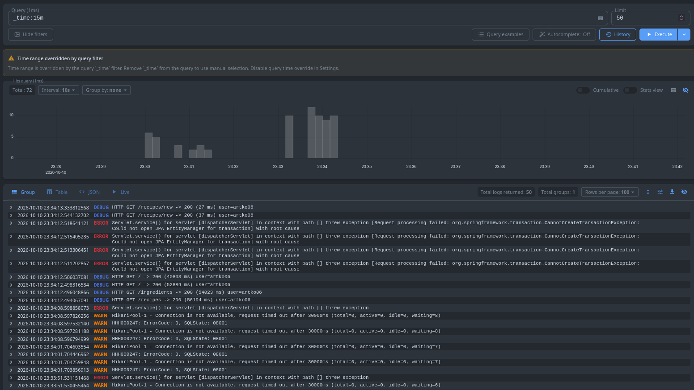
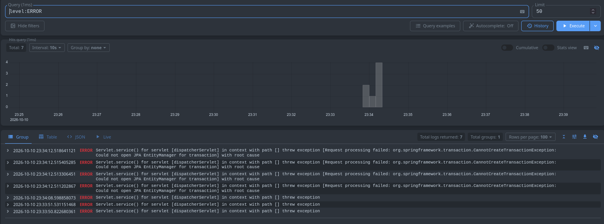
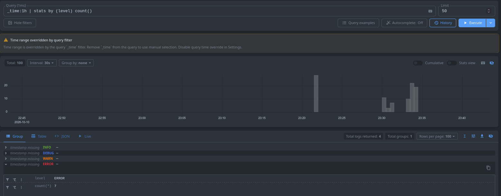
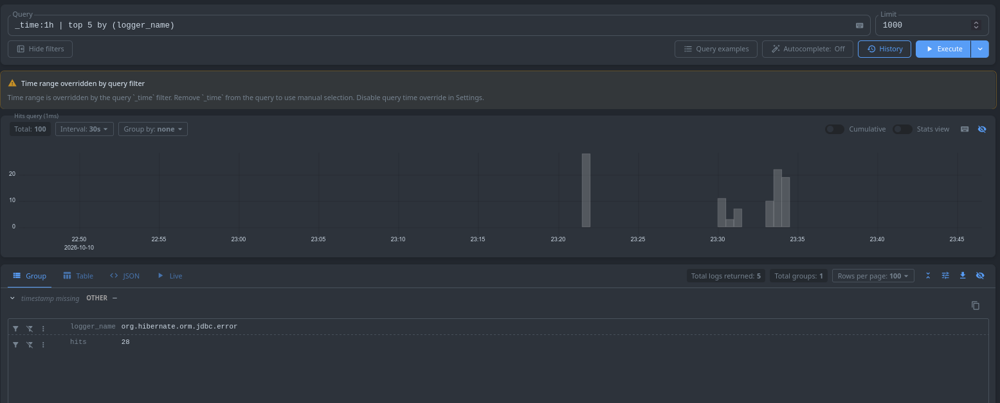
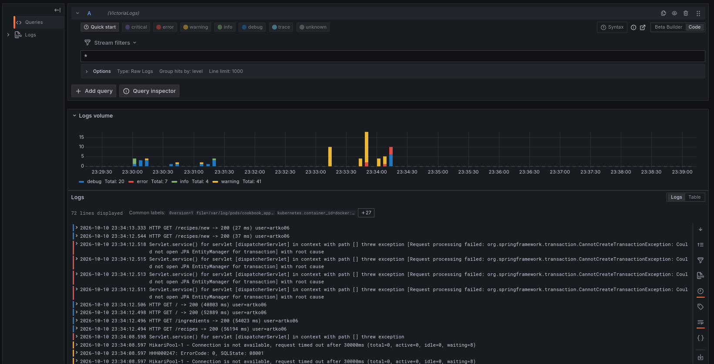

# Отчёт по заданию «Доставка логов приложения в Victoria Logs»

«Кулинарная книга» — Spring Boot 4.1.1 + Thymeleaf, PostgreSQL 16, развёрнута в
minikube (namespace `cookbook`, ДЗ №1/№2). В тот же кластер добавлены **Victoria Logs
(single-node)** и шиппер **Vector**.

```
Pod app (stdout: JSON) → /var/log/pods → Vector (DaemonSet)
   → Elasticsearch bulk → Service victoria-logs:9428 → PVC → vmui
```

## 1. Развёртывание Victoria Logs

Ручными манифестами в `k8s/victoria-logs/`:

| Файл | Объект |
|------|--------|
| `00-pvc.yaml` | `PersistentVolumeClaim victoria-logs-pvc` (2Gi) |
| `01-deployment.yaml` | `Deployment victoria-logs` (`victoriametrics/victoria-logs`, `-storageDataPath=/vlogs`, `-retentionPeriod=7d`, порт `9428`) |
| `02-service.yaml` | `Service victoria-logs` (ClusterIP:9428) |

Внутри кластера доступен по `victoria-logs:9428`, снаружи — по
`kubectl port-forward svc/victoria-logs 9428:9428 -n cookbook` (vmui: `/select/vmui/`).

## 2. JSON-логирование приложения

Включён встроенный structured logging Spring Boot (`application.yaml`):

```yaml
logging:
  structured:
    format:
      console: logstash
    json:
      add:
        service.name: cookbook
      rename:
        "[@timestamp]": timestamp
```

## 3. Способ доставки логов

Выбран **DaemonSet-шиппер Vector** с отправкой в Victoria Logs.
Манифесты — `k8s/vector/` (`ServiceAccount`, `RBAC`, `ConfigMap`, `DaemonSet`).

```yaml
sinks:
  vlogs:
    type: elasticsearch
    endpoints: ["http://victoria-logs:9428/insert/elasticsearch/"]
    api_version: v8
    query:
      _msg_field: message
      _time_field: timestamp
      _stream_fields: service.name,kubernetes.container_name
```

**Почему так:**
- **DaemonSet, а не сайдкар** — один агент на ноду читает готовые `/var/log/pods`,
  не нужно менять приложение или добавлять контейнер в каждый под.
- **Vector** — лёгкий, конфиг одним YAML, из коробки умеет `kubernetes_logs`,
  `parse_json`, фильтрацию и имеет Elasticsearch-sink.
- **ES-bulk, а не push из приложения** — Victoria Logs штатно принимает
  `/insert/elasticsearch/_bulk`, приложение остаётся 12-факторным («логи в stdout»).

## 4. LogsQL-запросы в vmui

**(а) Сырые записи за 15 минут — `_time:15m`**



Поток всех логов за последние 15 минут (72 записи): `DEBUG`, `WARN`, `ERROR`, `INFO`. Быстрый взгляд на последние события.

**(б) Фильтр по полю — `level:ERROR`**



Только ошибки (7 шт.) — `CannotCreateTransactionException: Could not open JPA
EntityManager` во время отключения БД. 

**(в) Группировка — `_time:1h | stats by (level) count()`**



Количество записей по уровням за час: 4 группы (`DEBUG`, `INFO`, `WARN`, `ERROR`).

**(г) Агрегат — `_time:1h | top 5 by (logger_name)`**



Топ-5 логгеров по числу записей; лидирует `org.hibernate.orm.jdbc.error` (28) —
следствие ошибок БД. Помогает найти «шумные» источники.

## 5. Бонус: Grafana + плагин VictoriaLogs

Развёрнута Grafana (`k8s/grafana/`: PVC, Secret, ConfigMap-datasource, Deployment,
Service). Официальный плагин `victoriametrics-logs-datasource` ставится из
GitHub-релиза через `GF_INSTALL_PLUGINS` (каталог grafana.com недоступен и отдаёт
HTTP 451), datasource провижинится на `http://victoria-logs:9428`. В Explore
выполняются те же LogsQL-запросы.

> Grafana открывается только при включённом VPN — без него недоступны
> внешние ресурсы (каталог плагинов grafana.com), нужные для установки плагина.



На скриншоте — Explore с подключённым datasource **VictoriaLogs**: запрос `*`
(Raw Logs), гистограмма объёма логов в разрезе уровня (`debug`/`error`/`info`/`warning`).

## 6. Команды демонстрации

```bash
# запуск приложения и зависимостей
kubectl apply -f k8s/spring-boot/

# развёртывание Victoria Logs и шиппера Vector
kubectl apply -f k8s/victoria-logs/
kubectl apply -f k8s/vector/

# вывод всех запущенных подов
kubectl get pods -n cookbook

# доступ к vmui Victoria Logs
kubectl port-forward svc/victoria-logs 9428:9428 -n cookbook
#   → http://localhost:9428/select/vmui/

# Grafana с плагином VictoriaLogs
kubectl apply -f k8s/grafana/
kubectl port-forward svc/grafana 3000:3000 -n cookbook
#   → http://localhost:3000  (admin / admin)
#   либо: minikube service grafana -n cookbook
```

## Состав артефактов

- `k8s/victoria-logs/` — Victoria Logs (PVC, Deployment, Service);
- `k8s/vector/` — шиппер Vector (SA, RBAC, ConfigMap, DaemonSet);
- `k8s/grafana/` — Grafana + плагин VictoriaLogs;
- `src/main/resources/application.yaml` и код логирования (`RequestLoggingFilter`,
  `SecurityEventListener`, `AuthController`, сервисы, `GlobalExceptionHandler`);
- `task/task3/screenshots/` — 4 скриншота vmui (+ Grafana);
- `task/task3/Отчёт.md` — настоящий отчёт.
