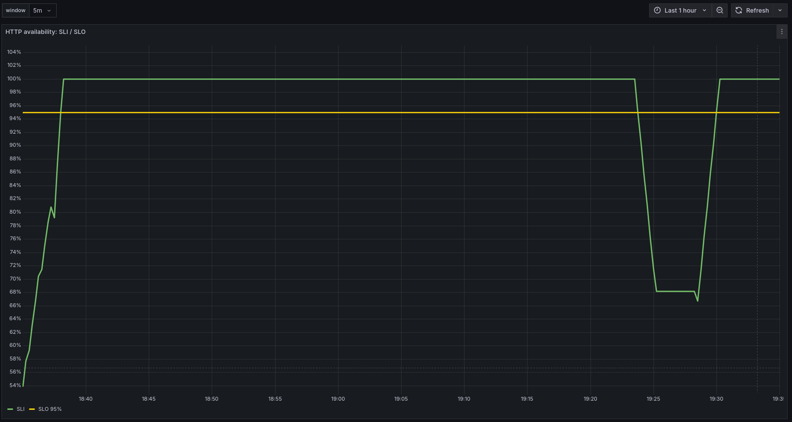
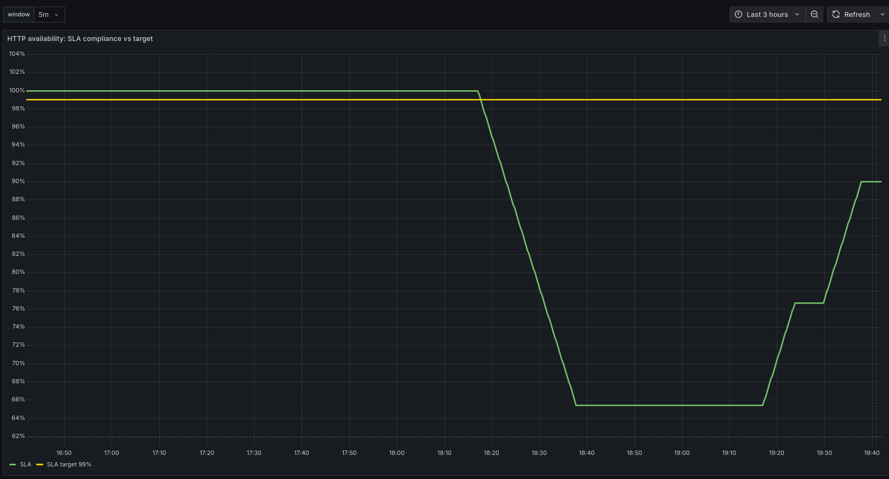
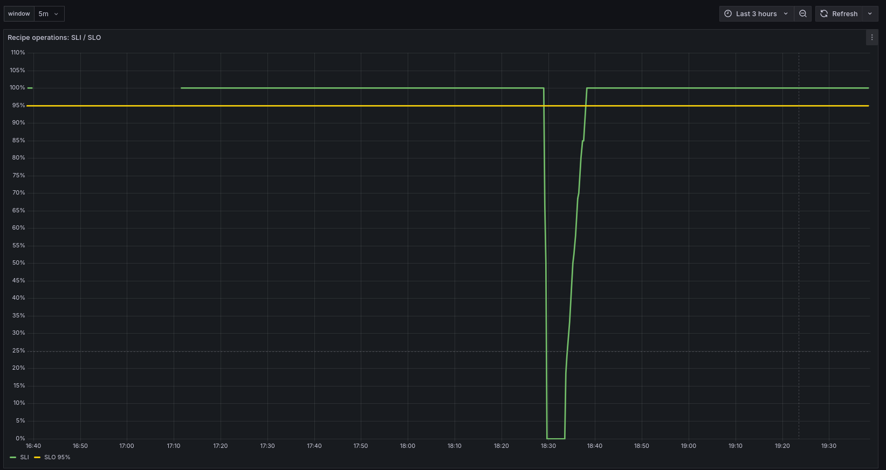
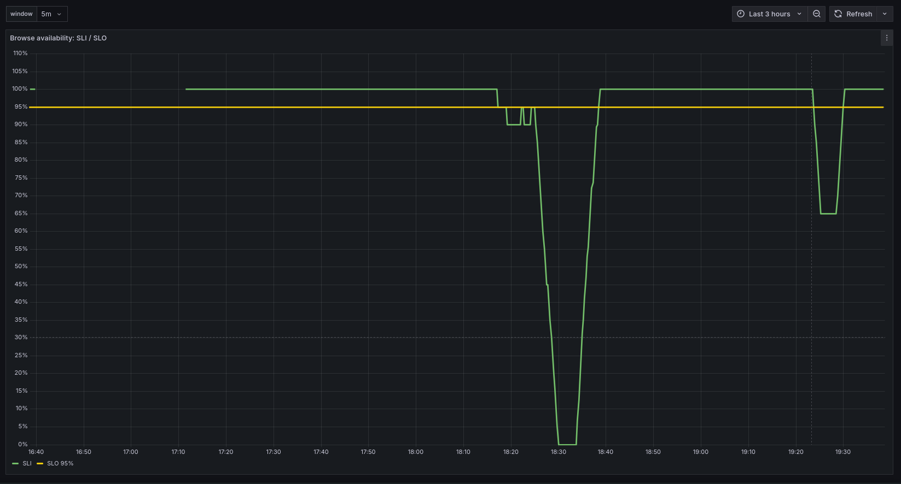
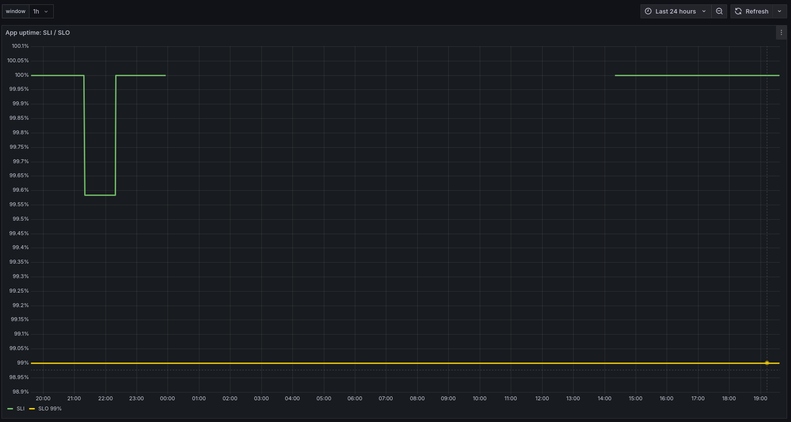
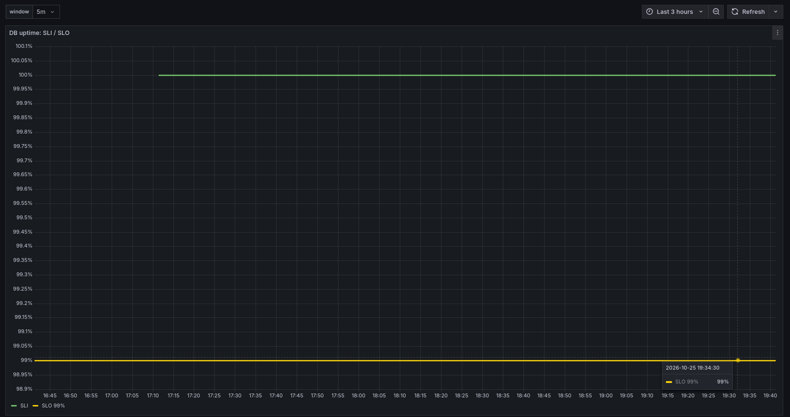

# Отчёт по заданию «SLI, SLO и SLA»

«Кулинарная книга» — Spring Boot 4.1.1 + Thymeleaf, PostgreSQL 16, minikube.
SLI/SLO/SLA визуализируются в Grafana по метрикам ДЗ №4 и метрикам пробера.

## Стек и схема

Spring Boot + Actuator/Micrometer, PostgreSQL + `postgres-exporter`,
VictoriaMetrics, `prober`, Grafana.

```text
app:8080 (UI/API) ── GET /api/v1/recipes ──> prober:9090
app:8081 (Actuator) ─┐
db:9187 (exporter) ──┼── scrape ──> VictoriaMetrics:8428 ──> Grafana
prober:9090 ─────────┘
```

Порты: app — `8080`, management — `8081`, пробер — `9090`.

## SLI, SLO и SLA

Окна: SLI/SLO — `window` (по умолчанию `1h`), SLA — SLI `5m` / окно `1h`.

| SLI | Тип | Метрика | SLO 1h |
|---|---|---|---|
| `app_uptime` | TBSLO | `up{app="app"}` | ≥ 99% |
| `http_availability` | RBSLO | `http_server_requests_seconds_count` | ≥ 95% |
| `recipe_operations` | RBSLO | тот же счётчик по `/recipes*`, `/api/v1/recipes*` | ≥ 95% |
| `browse_availability` | RBSLO | `cookbook_probe_runs_total` | ≥ 95% |
| `db_uptime` | TBSLO | `pg_up` | ≥ 99% |

SLA: SLO `HTTP availability (5m) >= 95%` выполняется **≥ 99% времени за 1 час**.

Цели: `99%` для app/db, `95%` для пользовательских сценариев.
Четыре SLI используют метрики ДЗ №4, пятый — пробер.

### Формулы

```text
SLI = good / total за window

SLO = SLI_window >= target
SLA = avg_over_time((SLI_5m >= bool SLO)[1h:]) or vector(0)
SLA target = 0.99
```

`target` — `0.99` для app/db и `0.95` для пользовательских SLI.
`4xx` не считаются ошибкой сервиса; «плохими» являются только `5xx`.
Готовые запросы: `task/task5/queries.md`.

## Пробер

Отдельный `Deployment prober`, 1 pod. Раз в 15 секунд:

```text
GET http://app:8080/api/v1/recipes?size=5
```

Успех — HTTP `2xx` и валидный JSON.

Метрики: `cookbook_probe_runs_total{result="success\|failure"}`,
`cookbook_probe_duration_seconds`, `cookbook_probe_up`.

Манифесты: `k8s/prober/`. Скрейп — по аннотациям `prometheus.io/*`.
SLO внутри пробера не считаются.

## Chaos для демонстрации

Управляемый chaos выключен по умолчанию: `DEMO_CHAOS_ENABLED=false`.

Эндпоинты: `POST /api/v1/chaos?errorRate=0.2`, `GET /api/v1/chaos`,
`POST /api/v1/chaos/reset`.

`ChaosFilter` применяется только к `/recipes*` и `/api/v1/recipes*` и возвращает
`500` без вызова контроллера. Actuator, статика и chaos-эндпоинт не затрагиваются.
`GET` в браузере безопасен: состояние меняет только `POST`.

## Grafana

Datasource: `VictoriaMetrics`, тип `Prometheus`.
Provisioning: `k8s/grafana/01-datasource-configmap.yaml`.

```text
http://vm-single-victoria-metrics-single-server.monitoring.svc:8428
```

```bash
kubectl port-forward svc/grafana 3000:3000 -n cookbook
```

Панели: 5 SLI с линиями SLO и одна SLA compliance (5m/1h) с целью `vector(0.99)`.
`window` по умолчанию `1h`; для демо можно `5m`.

## Проверка и демонстрация

### Подготовка

```bash
kubectl get pods -n cookbook
kubectl exec -n cookbook deploy/app -- printenv DEMO_CHAOS_ENABLED
# false

kubectl port-forward svc/app 8080:8080 -n cookbook
kubectl port-forward svc/grafana 3000:3000 -n cookbook
```

Grafana: `http://localhost:3000`, datasource `VictoriaMetrics`.
Если datasource отсутствует:

```bash
kubectl apply -k k8s/grafana/
kubectl rollout restart deploy/grafana -n cookbook
```

Если `/api/v1/chaos` отдаёт `404` — образ app старый, нужен rebuild и rollout.

### Baseline

Открыть панели SLI/SLO и SLA compliance.

Ожидаем: `app_uptime` и `db_uptime` ≈ `1`, остальные SLI ≈ `1`,
`SLA compliance` ≈ `1`.

### Chaos

```bash
kubectl set env deploy/app -n cookbook DEMO_CHAOS_ENABLED=true
kubectl rollout status deploy/app -n cookbook
curl -X POST 'http://localhost:8080/api/v1/chaos?errorRate=0.2'
```

Подождать 2–3 минуты. При `errorRate=0.2` падают `http_availability`,
`recipe_operations` и `browse_availability`, `app_uptime` и `db_uptime`
остаются около `1`. `SLA compliance` (5m/1h) тоже снижается.

Для быстрой демонстрации можно переключить `window` на `5m`;
SLA-панель остаётся фиксированной на `1h`.

Для более сильного падения временно поставить `errorRate=1.0`.

### Восстановление

```bash
curl -X POST 'http://localhost:8080/api/v1/chaos/reset'
```

## Скриншоты и скринкаст

### HTTP availability: SLI / SLO



Падение SLI ниже SLO `95%` во время chaos и восстановление после reset.

### HTTP availability: SLA compliance vs target



SLA compliance падает ниже target `99%` и восстанавливается после reset.

### Recipe operations: SLI / SLO



Падение SLI до `0%` во время chaos и восстановление.

### Browse availability: SLI / SLO



Падение проверки пользовательского сценария при ошибках `5xx` и восстановление.

### App uptime: SLI / SLO



Кратковременное падение `up` при перезапуске приложения; SLO `99%` не нарушен.

### DB uptime: SLI / SLO



PostgreSQL стабилен, доступность `100%`.

Скринкаст: `task/task5/screencast.mp4`.
