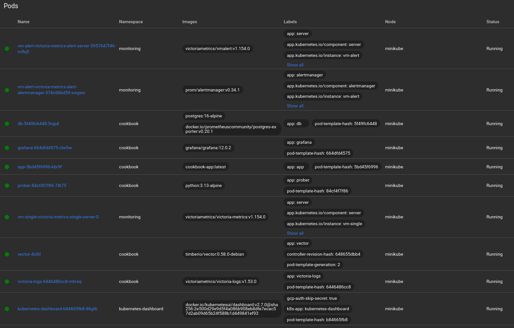
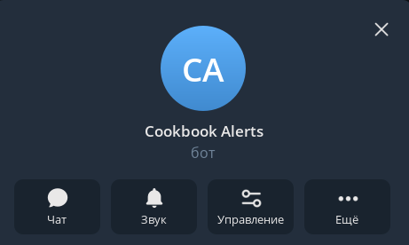
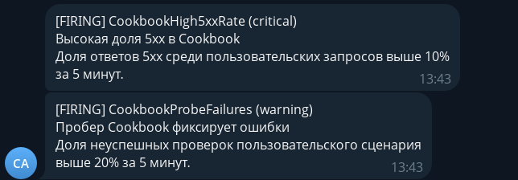
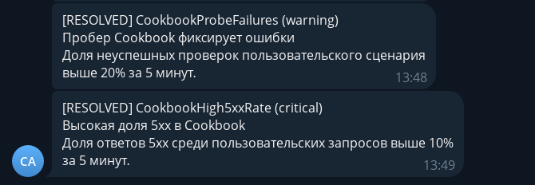
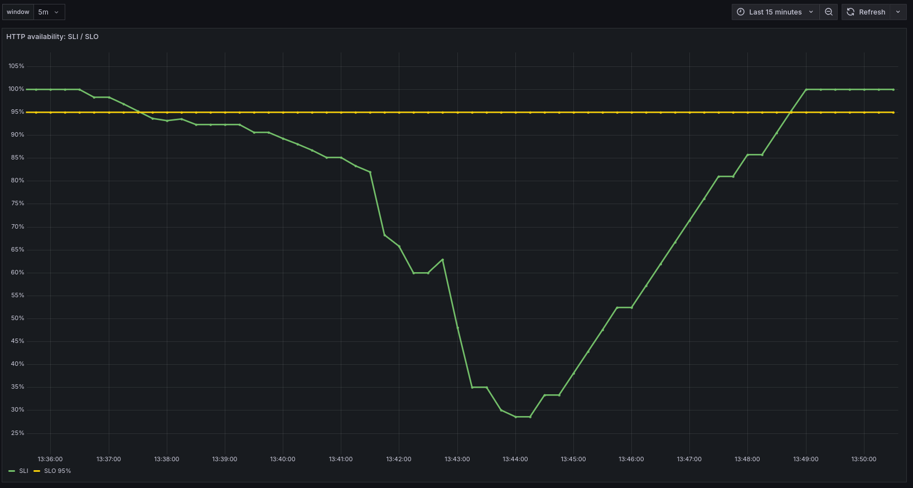
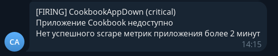
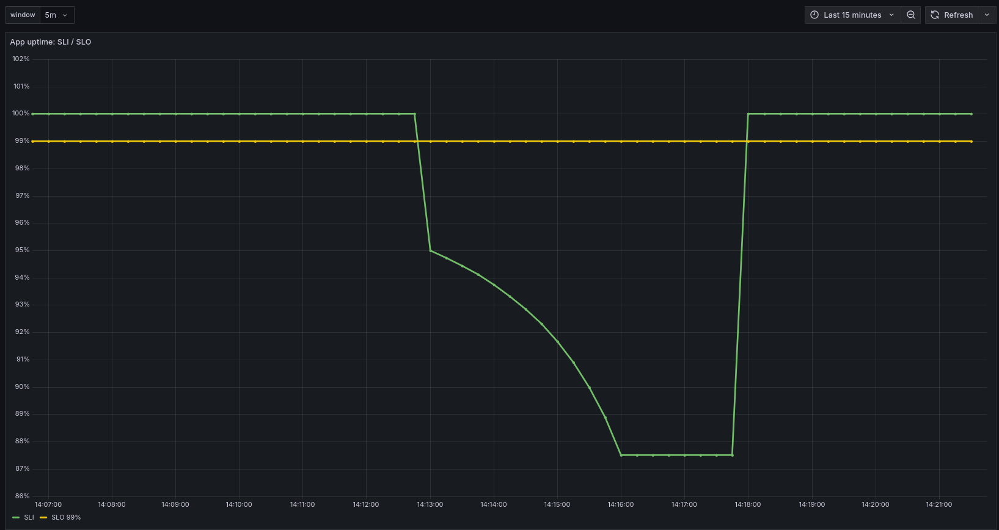

# Отчёт по заданию «Алерты для мониторинга сервиса»

«Кулинарная книга» — Spring Boot + PostgreSQL в minikube. Алерты построены на
метриках VictoriaMetrics, вычисляются `vmalert` и отправляются Alertmanager в
Telegram.

```text
app / db / prober → VictoriaMetrics → vmalert → Alertmanager → Telegram
```

## Алерты

| Алерт | Метрика | Условие | for | Severity |
|---|---|---|---|---|
| `CookbookAppDown` | `up` | `up{app="app"} == 0` или серия отсутствует | 2m | critical |
| `CookbookProbeFailures` | `cookbook_probe_runs_total` | доля неуспешных пробера > 20% | 5m | warning |
| `CookbookDbDown` | `pg_up` | `pg_up{app="db"} == 0` или серия отсутствует | 2m | critical |
| `CookbookHigh5xxRate` | `http_server_requests_seconds_count` | доля 5xx > 10% | 5m | critical |

Три алерта сервисные, `CookbookHigh5xxRate` — framework/Actuator: метрика
`http_server_requests_seconds_count` отдаётся Spring Boot Actuator/Micrometer.

Пороги выбраны так:

- `2m` для `up`/`pg_up` — чтобы одиночный неудачный scrape не поднимал шум;
- `5m` и `20%` для пробера — отсекаем кратковременные сбои, но фиксируем
  деградацию пользовательского сценария;
- `5m` и `10%` для 5xx — 4xx и запросы Actuator не считаются ошибкой сервиса.

## Конфигурация

- `k8s/alerting/vmalert-rules.yaml` — ConfigMap `vmalert-rules` с четырьмя правилами;
- `k8s/alerting/values-alert.yaml` — Helm values для `vm/victoria-metrics-alert`:
  datasource на `vm-single`, Alertmanager, Telegram receiver, монтирование Secret;
- `k8s/alerting/kustomization.yaml` — ConfigMap и `Secret alertmanager-telegram`
  из локального `telegram-secret.env`;
- `k8s/alerting/README.md` — запуск, проверка и демонстрация.

Telegram-бот создан через `@BotFather`; токен и chat id лежат в Secret
`alertmanager-telegram` и в git не попадают.

## Скриншоты

### 1. Запущенные поды



Экран Kubernetes Dashboard со списком подов. Видно, что весь стек запущен:

- `vm-alert-victoria-metrics-alert-server-...` — vmalert `v1.154.0`, Running;
- `vm-alert-victoria-metrics-alert-alertmanager-...` — Alertmanager `v0.34.1`, Running;
- `app-...` — приложение `cookbook-app:latest`, Running;
- `db-...` — PostgreSQL 16 + `postgres-exporter`, Running;
- `prober-...` — пробер, Running;
- `vm-single-victoria-metrics-single-server-0` — VictoriaMetrics, Running;
- `grafana-...`, `victoria-logs-...`, `vector-...` — также Running.

То есть и приложение, и источник метрик, и цепочка оповещения работают.

### 2. Telegram-бот



Карточка бота **Cookbook Alerts** в Telegram. Бот создан через `@BotFather` и
используется Alertmanager как получатель уведомлений.

### 3. Срабатывание алертов по 5xx и проберу



Два сообщения в Telegram в 13:43:

- `[FIRING] CookbookHigh5xxRate (critical)` — «Высокая доля 5xx в Cookbook»,
  «Доля ответов 5xx среди пользовательских запросов выше 10% за 5 минут»;
- `[FIRING] CookbookProbeFailures (warning)` — «Пробер Cookbook фиксирует ошибки»,
  «Доля неуспешных проверок пользовательского сценария выше 20% за 5 минут».

Это результат chaos-режима: приложение начало отдавать 500 на `/recipes*`, из-за
чего выросла доля 5xx и пробер начал фиксировать неуспешные проверки.

### 4. Восстановление алертов по 5xx и проберу



Сообщения в 13:48–13:49:

- `[RESOLVED] CookbookProbeFailures (warning)`;
- `[RESOLVED] CookbookHigh5xxRate (critical)`.

Видно, что после `chaos/reset` условия перестали выполняться, vmalert перевёл
алерты в resolved, а Alertmanager отправил уведомления благодаря
`send_resolved: true`.

### 5. Динамика HTTP availability в Grafana



Панель **HTTP availability: SLI / SLO**, окно `5m`, последние 15 минут. Зелёная
линия SLI стартует со 100%, около 13:38 опускается ниже жёлтой линии SLO `95%`,
к 13:44 падает примерно до `30%`, затем восстанавливается до `100%` к 13:49.

График совпадает по времени с firing/resolved сообщениями: падение — работа
chaos, рост обратно — `chaos/reset`.

### 6. Срабатывание CookbookAppDown



Сообщение в 14:15:

```text
[FIRING] CookbookAppDown (critical)
Приложение Cookbook недоступно
Нет успешного scrape метрик приложения более 2 минут
```

Алерт сработал после `kubectl scale deploy/app --replicas=0`: target приложения
исчез.

### 7. Восстановление CookbookAppDown


Сообщение в 14:17:

```text
[RESOLVED] CookbookAppDown (critical)
Приложение Cookbook недоступно
Нет успешного scrape метрик приложения более 2 минут
```

После возврата `replicas=1` приложение снова стало доступно для scrape, и алерт
перешёл в resolved.

### 8. Динамика App uptime в Grafana



Панель **App uptime: SLI / SLO**, окно `5m`, SLO `99%`. SLI держится на `100%`,
около 14:12:45 начинает падать, к 14:16 опускается примерно до `87.5%`, а после
14:17 возвращается к `100%`.

Это соответствует демонстрации `CookbookAppDown`: приложение было
отмасштабировано до нуля, перестало скрейпиться, затем было возвращено.

## Вывод

Реализованы и проверены четыре алерта: три сервисных и один framework/Actuator.
На скриншотах показаны:

- срабатывание `CookbookHigh5xxRate` и `CookbookProbeFailures` при chaos;
- их восстановление после reset;
- срабатывание и восстановление `CookbookAppDown` при остановке приложения;
- динамика SLI/SLO в Grafana, подтверждающая изменения;
- доставка уведомлений в Telegram.

