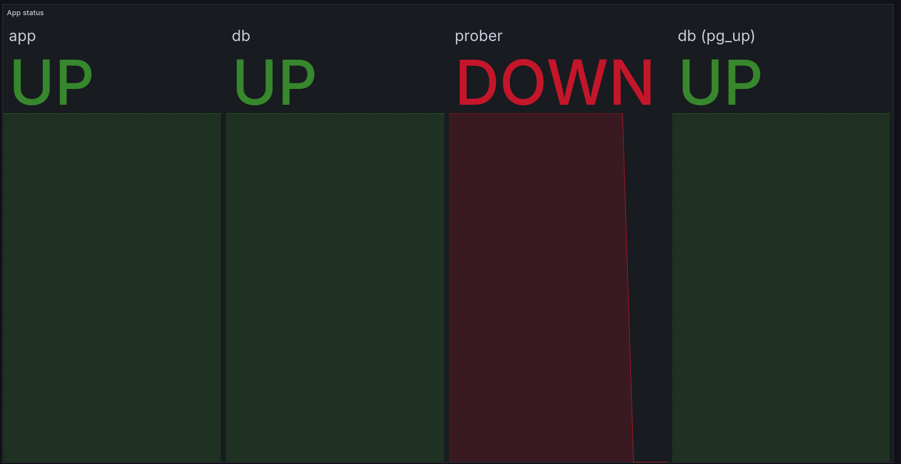
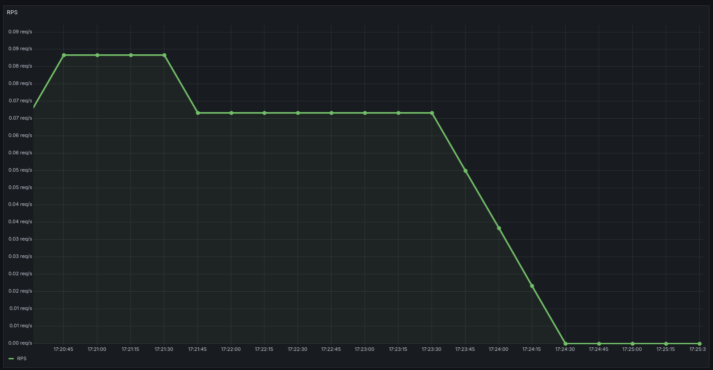
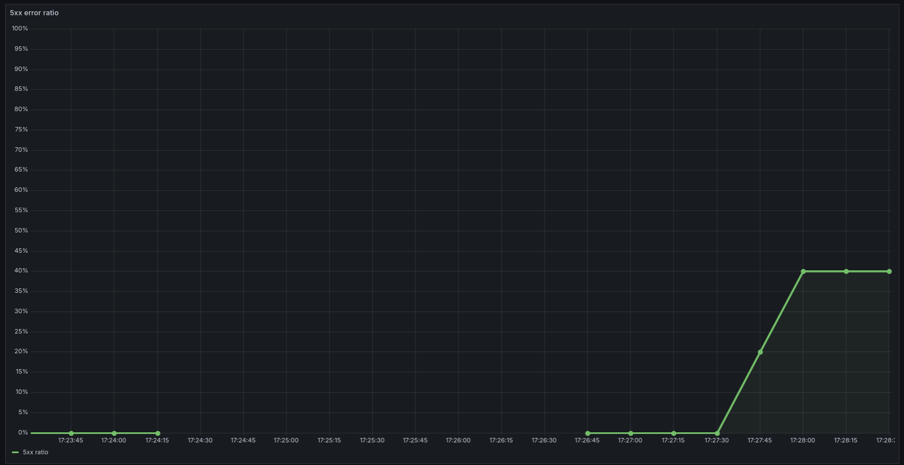
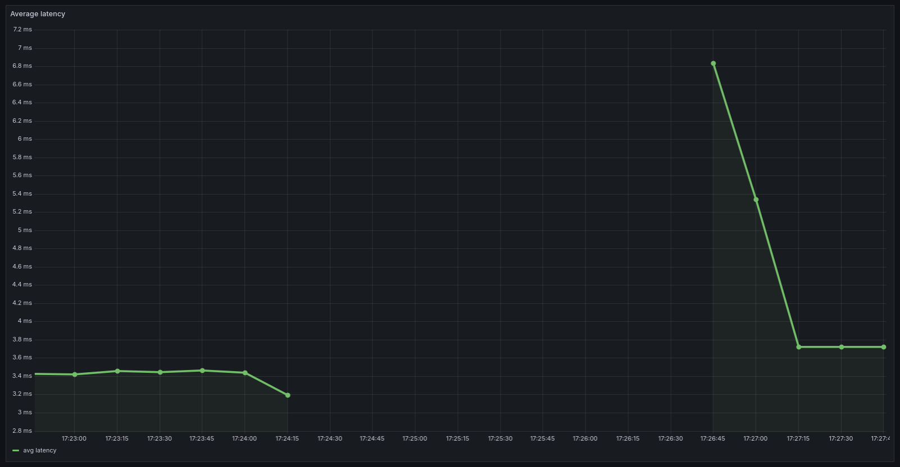
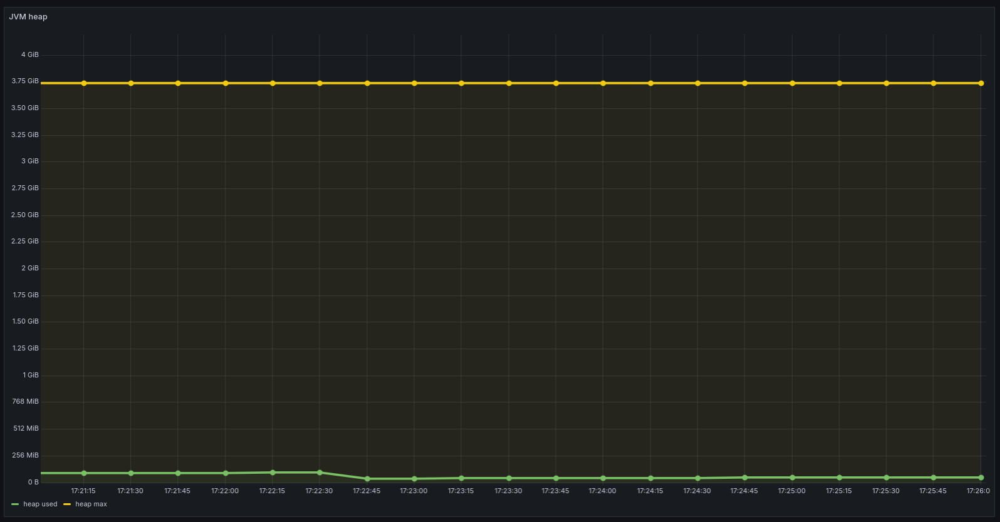
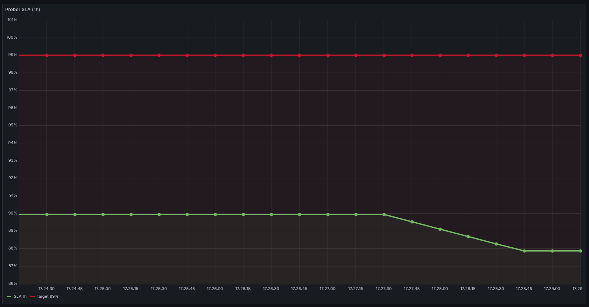

# Отчёт по заданию «Дашборды в Grafana»

«Кулинарная книга» — Spring Boot + PostgreSQL в minikube. Дашборд собран в
Grafana на datasource VictoriaMetrics: метрики приложения, пробера и
`postgres-exporter`

## Cхема

```text
app:8080 (UI/API) ── GET /api/v1/recipes ──> prober:9090
app:8081 (Actuator) ─┐
db:9187 (exporter) ──┼── scrape ──> VictoriaMetrics:8428 ──> Grafana
prober:9090 ─────────┘
```

## Дашборд приложения

Дашборд: `Cookbook - Application`

Старые панели SLI/SLO из ДЗ №5 сохранены. Добавлены минимально необходимые
панели по Golden Signals / RED / USE:

| Панель | Назначение | Почему выбрана |
|---|---|---|
| `App status` | Статусы `app`, `db`, `prober`, PostgreSQL | Базовая доступность сервисов |
| `RPS` | Суммарный RPS приложения | Traffic |
| `5xx error ratio` | Доля ответов `5xx` | Errors |
| `Average latency` | Средняя длительность запросов | Duration |
| `JVM heap` | Используемая и максимальная heap-память | Runtime/детализация |
| `Prober SLA (1h)` | SLA пробера за час | Отдельная панель по условию |

Для `App status` использованы `label_keep`/`label_del`: в VictoriaMetrics
`absent_over_time` иначе сохраняет лишние метки, из-за чего появляются дубли
`UP/DOWN`. Значения: `1` → `UP` (зелёный), `0` → `DOWN` (красный).

## Демонстрация

```bash
kubectl get pods -n cookbook

# Доступ к Grafana
kubectl port-forward svc/grafana 3000:3000 -n cookbook

# App status и RPS: намеренно выключаем prober
kubectl scale deploy/prober -n cookbook --replicas=0

# Возвращаем prober
kubectl scale deploy/prober -n cookbook --replicas=1

# 5xx error ratio, average latency, Prober SLA: включаем chaos
kubectl port-forward svc/app 8080:8080 -n cookbook
curl -X POST 'http://localhost:8080/api/v1/chaos?errorRate=0.75'

# Сброс chaos после демонстрации
curl -X POST 'http://localhost:8080/api/v1/chaos/reset'
```

## Скриншоты

### App status

```promql
# app, db, prober
max by (app) (last_over_time(up{
  job="kubernetes-pods",
  namespace="cookbook",
  app=~"app|db|prober"
}[1m]))
or
label_keep(absent_over_time(up{job="kubernetes-pods",namespace="cookbook",app="app"}[1m]), "app") * 0
or
label_keep(absent_over_time(up{job="kubernetes-pods",namespace="cookbook",app="db"}[1m]), "app") * 0
or
label_keep(absent_over_time(up{job="kubernetes-pods",namespace="cookbook",app="prober"}[1m]), "app") * 0

# PostgreSQL
max(last_over_time(pg_up{namespace="cookbook"}[1m]))
or
label_del(absent_over_time(pg_up{namespace="cookbook"}[1m]), "namespace") * 0
```



`prober` масштабирован в 0, поэтому его статус `DOWN`; `app`, `db` и `pg_up` —
`UP`.

### RPS

```promql
sum(rate(http_server_requests_seconds_count{
  application="cookbook",
  uri!~"/actuator.*"
}[$__rate_interval]))
```



Базовый трафик от `prober` около `0.07 req/s`; после выключения `prober` RPS падает до 0.
Запросы Actuator исключены, чтобы график показывал пользовательскую нагрузку.

### 5xx error ratio

```promql
sum(rate(http_server_requests_seconds_count{
  application="cookbook",
  uri!~"/actuator.*",
  status=~"5.."
}[$__rate_interval]))
/
sum(rate(http_server_requests_seconds_count{
  application="cookbook",
  uri!~"/actuator.*"
}[$__rate_interval]))
```



После включения chaos с `errorRate=0.75` доля `5xx` выросла примерно до 40%.

### Average latency

```promql
sum(rate(http_server_requests_seconds_sum{
  application="cookbook",
  uri!~"/actuator.*"
}[$__rate_interval]))
/
sum(rate(http_server_requests_seconds_count{
  application="cookbook",
  uri!~"/actuator.*"
}[$__rate_interval]))
```



Во время простоя `prober` есть разрыв в данных; после восстановления latency
около 3–7 мс.

### JVM heap

```promql
sum(jvm_memory_used_bytes{application="cookbook",area="heap"})
sum(jvm_memory_max_bytes{application="cookbook",area="heap"})
```



Используется около 100 MiB heap при максимуме около 3.75 GiB; график стабилен.

### Prober SLA (1h)

```promql
avg_over_time((
  (
    sum(increase(cookbook_probe_runs_total{result="success"}[5m]))
    /
    sum(increase(cookbook_probe_runs_total[5m]))
  ) >= bool 0.95
)[1h:])
or vector(0)
```

Целевой SLA:

```promql
vector(0.99)
```



SLA снижается с ~90% до ~88% на фоне chaos и остаётся ниже target 99%.
Панель фиксирована на окне `1h`.

## PostgreSQL Exporter

Импортирован готовый дашборд Grafana.com ID `9628` — `PostgreSQL Exporter`,
datasource `VictoriaMetrics`.

Выбирается instance `10.244.10.21:9187`. Основные панели PostgreSQL
работают.

## Артефакты

- `k8s/grafana/dashboards/Cookbook_Application.json` — экспорт дашборда приложения;
- `k8s/grafana/dashboards/grafana_postgresql-exporter.json` — экспорт дашборда PostgreSQL Exporter;
- `task/task7/screencast.mp4` — скринкаст с демонстрацией дашбордов.
