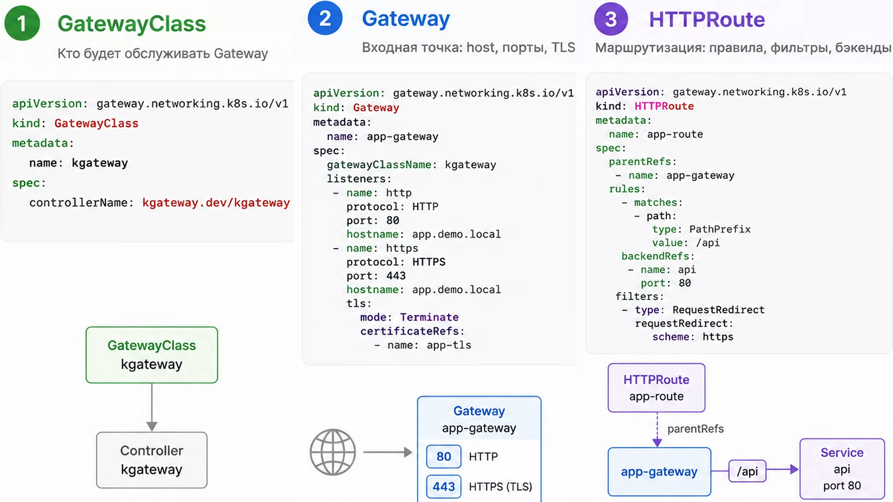
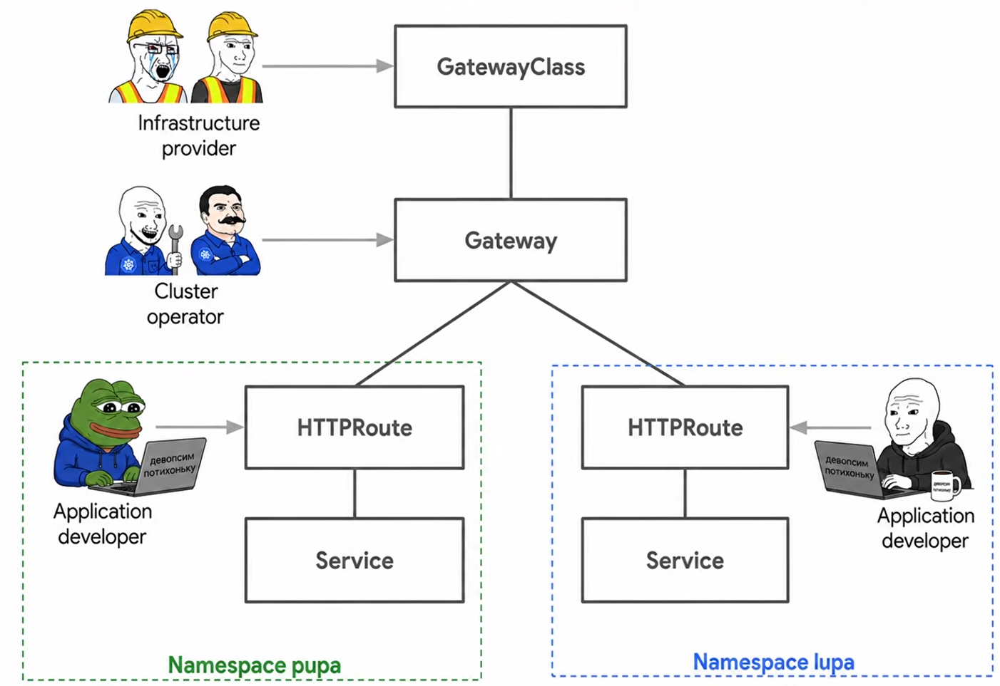
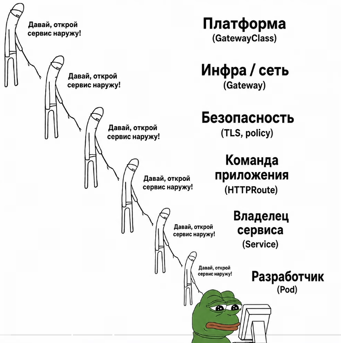

# Отчёт по заданию «Стратегии развёртывания»

«Кулинарная книга» — Spring Boot 4.1.1 + Thymeleaf, PostgreSQL 16, minikube.
Приложение развёрнуто в нескольких репликах, трафиком между версиями управляет
**Envoy Gateway** через **Gateway API**.

```text
traffic.sh :8888 ──port-forward──> Envoy-прокси Gateway `eg`
                                        │
                                  HTTPRoute `cookbook`
                                   ├── Service cookbook-v1 → 3 пода v1.0.0
                                   └── Service cookbook-v2 → 3 пода v2.0.0
                                        │
                              PostgreSQL `db` (namespace cookbook)
```

## Приложение в нескольких подах

| Требование | Реализация |
|---|---|
| Реплики ≥ 2 | 3 + 3 пода (`cookbook-v1`, `cookbook-v2`), в rolling — 6 подов одного Deployment |
| Состояние вне пода | Spring Session JDBC: сессии в PostgreSQL |
| Пробы | `startupProbe`, `readinessProbe`, `livenessProbe` на management-порту `8081` |
| Версия в ответе | заголовки `X-App-Version`, `X-App-Instance` |
| Версия в метрике | метка `version` и тег `version` у `http_server_requests_*` |

- **Сессии.** Таблицы `SPRING_SESSION*` создаёт миграция
  `V3__spring_session.sql`, а `spring.session.jdbc.initialize-schema: never`
  отключает DDL из приложения: схему готовит Flyway один раз, поды не
  конкурируют за неё при старте. Сессия общая для всех реплик и переживает
  удаление пода.
- **Пробы.** `startupProbe` ждёт открытия `8081` (до 30 попыток), `readinessProbe`
  снимает под с Service, пока приложение не готово, `livenessProbe` перезапускает
  зависший процесс. Группы `/actuator/health/**` открыты в `SecurityConfig`.
- **Версия.** `APP_VERSION` из манифеста попадает в `VersionResponseFilter`
  (заголовки ответа), в метку `version` pod template и через
  `management.metrics.tags.version` — в метрики. Версии отличаются только этим
  значением, поэтому распределение трафика видно и в `curl`, и в Grafana.
- **Завершение.** Graceful shutdown Spring Boot 4: старый под получает `SIGTERM`,
  доигрывает запросы и только потом удаляется.

## Gateway API

Gateway API разделяет зоны ответственности: инфраструктура описывает точки входа,
команда приложения — только правила маршрутизации.



Три объекта, из которых состоит стенд:

| Объект | Кто создаёт | Что задаёт |
|---|---|---|
| `GatewayClass` | инфраструктура | контроллер, который обслуживает Gateway (`envoy-gateway`) |
| `Gateway` | кластерный оператор | listener: протокол, порт, hostname, TLS |
| `HTTPRoute` | команда приложения | matches, filters, backendRefs |



`GatewayClass` и `Gateway` — общие для кластера, `HTTPRoute` живёт в namespace
приложения и подключается к Gateway через `parentRefs`. Один Gateway может
обслуживать маршруты нескольких namespace.



Запрос «открой сервис наружу» проходит цепочку платформа → сеть → безопасность →
HTTPRoute → Service → Pod. На стенде эту цепочку замыкают `GatewayClass eg`,
`Gateway eg` в `cookbook-deploy` и `HTTPRoute cookbook`.

## Стратегии

| Стратегия | Механизм | Наблюдаемый результат |
|---|---|---|
| Rolling | замена подов одного Deployment | v1 → смесь версий → v2 |
| Blue/Green | смена `backendRefs` одного `HTTPRoute` | ступенька 0 → 100% и обратно |
| Canary | веса `backendRefs` | 90/10 → 50/50 → 0/100 |
| A/B | `matches` по заголовку | v2 только у выбранной аудитории |
| Shadow | фильтр `RequestMirror` | ответы от v1, копия трафика в v2 |

### 1. Rolling

Один Deployment `cookbook` на 6 реплик, `maxSurge: 1`, `maxUnavailable: 0`.
Манифесты `strategies/rolling/01-app-v1.yaml` и `02-app-v2.yaml` отличаются
только `APP_VERSION`; второй применяется поверх первого, Service и HTTPRoute не
меняются.

Kubernetes поднимает один новый под, ждёт `Ready`, гасит один старый, и так до
полной замены. В `traffic.sh` видно чередование `v1.0.0`/`v2.0.0`, затем только
`v2.0.0`; старый ReplicaSet остаётся с 0 реплик. Откат — применение
`01-app-v1.yaml` (не `rollout undo`, чтобы не расходилась аннотация
`last-applied-configuration`).

### 2. Blue/Green

Оба Deployment и оба Service подняты одновременно. Переключение — один
`HTTPRoute cookbook`:

- `strategies/blue-green/httproute-green.yaml` — весь трафик на `cookbook-v1`;
- `strategies/blue-green/httproute-blue.yaml` — весь трафик на `cookbook-v2`.

Смена маршрута применяется за секунды, потому что поды уже готовы: в трафике
мгновенно меняется версия, на графике — ступенька `0 → 100%`. Откат — тот же
`httproute-green.yaml`.

### 3. Canary

Обе версии в строю, доля задаётся `weight` в `backendRefs`:

| Файл | v1 | v2 |
|---|---|---|
| `httproute-90-10.yaml` | 90 | 10 |
| `httproute-50-50.yaml` | 50 | 50 |
| `httproute-0-100.yaml` | 0 | 100 |

Вес — это доля **запросов**, а не подов: Envoy делит трафик по весам, а внутри
выбранного бэкенда распределяет его по эндпоинтам. Поэтому 10% получает
`cookbook-v2` целиком, независимо от числа её реплик. Шаги применяются без
остановки трафика, откат — предыдущий файл с меньшим весом v2.

### 4. A/B

`strategies/ab/httproute-ab.yaml` содержит два правила:

1. `matches.headers: x-user-group: beta` → `cookbook-v2`;
2. по умолчанию → `cookbook-v1`.

Проверка:

```bash
curl -sI http://localhost:8888/api/v1/recipes | grep -i x-app-version                 # v1.0.0
curl -sI -H 'x-user-group: beta' http://localhost:8888/api/v1/recipes | grep -i x-app-version  # v2.0.0
```

Так же можно прогнать весь поток бета-аудиторией:
`EXTRA_HEADER='x-user-group: beta' ./task/task8/scripts/traffic.sh`.

### 5. Shadow

`strategies/shadow/httproute-shadow.yaml` отправляет пользователя на
`cookbook-v1` и добавляет фильтр `RequestMirror` на `cookbook-v2`. Ответ
пользователю возвращает только v1, копия запроса уходит в v2 и её ответ
отбрасывается.

Наблюдение: `traffic.sh` показывает только `v1.0.0`, а в логах v2 идут те же
запросы, и `http_server_requests_seconds_count{version="v2.0.0"}` растёт. Фильтр
`RequestMirror` входит в стандартный канал Gateway API `v1`, experimental CRD не
нужны (проверено на Envoy Gateway `v1.10.0`).

## Мониторинг

Дашборд **K8s Deployment Strategies (Gateway API)**,
`k8s/deploy-strategies/monitoring/deploy-strategies-dashboard.json`,
datasource VictoriaMetrics:

- **RPS по версиям** — `sum(rate(http_server_requests_seconds_count{...}[2m])) by (version)`;
- **Доля v2 в трафике, %** — отношение RPS v2 к сумме RPS v1 и v2.

Запросы фильтруют `namespace="cookbook-deploy"` и `application="cookbook"`,
поэтому legacy `app` из `cookbook` в графики не попадает. Скрейп идёт по
аннотациям `prometheus.io/*` на pod template, метка `version` копируется в
метрики.

## Скринкасты

- `rolling.mp4` — замена подов при непрерывном трафике и плавный откат;
- `blue_green.mp4` — переключение green → blue и мгновенный откат;
- `canary.mp4` — 90/10 → 50/50 → 0/100 распределение трафика по весам;
- `ab.mp4` — `curl` с `x-user-group: beta` и без него;
- `shadow.mp4` — ответы от v1 и зеркалированные запросы в метриках v2.
