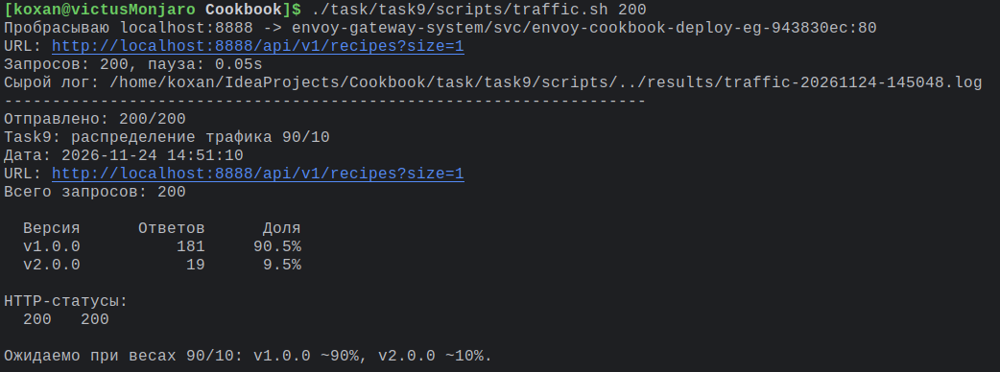
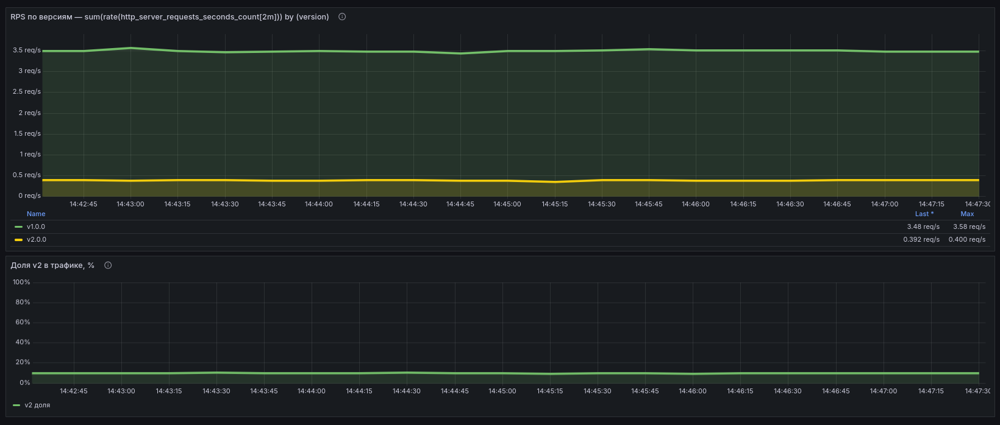

# Отчёт по заданию «Балансировка трафика с Gateway API»

«Кулинарная книга» — Spring Boot + Thymeleaf, PostgreSQL 16, minikube.
Трафик между двумя версиями приложения распределяет **Envoy Gateway** через
**Gateway API**.

```text
traffic.sh :8888 ──port-forward──> Envoy-прокси Gateway `eg`
                                        │
                                  HTTPRoute `cookbook`
                                   ├── 90% → Service cookbook-v1 → 3 пода v1.0.0
                                   └── 10% → Service cookbook-v2 → 3 пода v2.0.0
                                        │
                              PostgreSQL `db` (namespace cookbook)
```

## Развёртывание

| Ресурс | Файл | Параметры |
|---|---|---|
| Namespace | `k8s/gateway-weights/00-namespace.yaml` | `cookbook-deploy` |
| Deployment + Service v1 | `k8s/gateway-weights/01-app-v1.yaml` | 3 реплики, `ClusterIP`, `APP_VERSION=v1.0.0` |
| Deployment + Service v2 | `k8s/gateway-weights/02-app-v2.yaml` | 3 реплики, `ClusterIP`, `APP_VERSION=v2.0.0` |
| Gateway | `k8s/gateway-weights/03-gateway.yaml` | `GatewayClass eg`, `Gateway eg`, HTTP:80 |
| HTTPRoute | `k8s/gateway-weights/04-httproute-90-10.yaml` | v1 — 90, v2 — 10 |

Обе версии используют один образ `cookbook-app:latest`; версия задаётся
переменной `APP_VERSION` и возвращается в заголовке `X-App-Version`.

Запуск:

```bash
./task/task9/scripts/setup.sh
./task/task9/scripts/traffic.sh 200
```

`setup.sh` собирает образ, устанавливает Envoy Gateway, поднимает PostgreSQL из
`k8s/spring-boot`, применяет манифесты task9 и ждёт готовности подов.
Доступ к приложению — через `port-forward` на Envoy-прокси: на minikube Gateway
может иметь `Programmed=False` с `AddressNotAssigned`, это не мешает работе.

Состояние стенда:

```text
deployment.apps/cookbook-v1   3/3
deployment.apps/cookbook-v2   3/3
service/cookbook-v1           ClusterIP
service/cookbook-v2           ClusterIP

cookbook-v1=90
cookbook-v2=10
```

## HTTPRoute

```yaml
apiVersion: gateway.networking.k8s.io/v1
kind: HTTPRoute
metadata:
  name: cookbook
  namespace: cookbook-deploy
spec:
  parentRefs:
    - name: eg
  rules:
    - backendRefs:
        - name: cookbook-v1
          port: 80
          weight: 90
        - name: cookbook-v2
          port: 80
          weight: 10
```

`weight` задаёт долю запросов, а не количество подов. Внутри выбранного Service
Envoy отдельно балансирует запросы по трём эндпоинтам.

## Результаты 200 запросов

`traffic.sh` пробрасывает локальный порт на Envoy-прокси, отправляет 200 запросов
на `/api/v1/recipes?size=1` и считает ответы по заголовку `X-App-Version`.

| Версия | Ответов | Доля |
|---|---:|---:|
| `v1.0.0` | 181 | 90.5% |
| `v2.0.0` | 19 | 9.5% |
| **Всего** | **200** | **100%** |

Все 200 ответов — HTTP `200`.



Сырые данные:

- `task/task9/results/traffic-20261124-145048.log` — 200 запросов;
- `task/task9/results/summary-20261124-145048.txt` — итоговая таблица.

## Grafana

Datasource — VictoriaMetrics, панели по метрике
`http_server_requests_seconds_count`.

RPS по версиям:

```promql
sum(rate(http_server_requests_seconds_count{
  namespace="cookbook-deploy",
  application="cookbook",
  uri!~"/actuator.*"
}[2m])) by (version)
```

Доля v2:

```promql
100 *
sum(rate(http_server_requests_seconds_count{
  namespace="cookbook-deploy",
  application="cookbook",
  version="v2.0.0",
  uri!~"/actuator.*"
}[2m]))
/
sum(rate(http_server_requests_seconds_count{
  namespace="cookbook-deploy",
  application="cookbook",
  version=~"v1.0.0|v2.0.0",
  uri!~"/actuator.*"
}[2m]))
```

На скриншоте последние значения: v1 — `3.48 req/s`, v2 — `0.392 req/s`;
доля v2 — около `10.1%`.



## Вывод

Фактическое распределение — **90.5% на v1 и 9.5% на v2** — соответствует
заданным весам **90/10**. Отклонение `0.5 п.п.` объясняется случайной выборкой:
на 200 запросах ожидаемо около 20 ответов v2, получено 19.

## Артефакты

- `k8s/gateway-weights/` — Deployment, Service, Gateway и HTTPRoute;
- `task/task9/scripts/` — `setup.sh`, `traffic.sh`, `teardown.sh`;
- `task/task9/results/` — сырой лог и summary;
- `task/task9/screenshots/weight_distribution_sh.png` — вывод 200 запросов;
- `task/task9/screenshots/weight_distribution_grafana.png` — Grafana.
